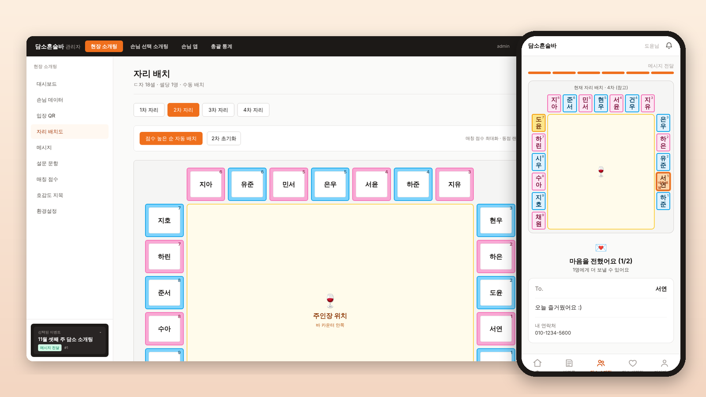
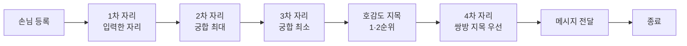
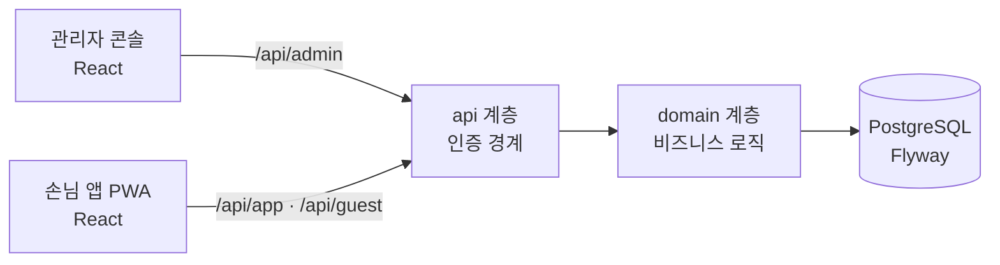

<div align="center">

# 🍷 담소 — 매장 소개팅 이벤트 운영 플랫폼

**오프라인 소개팅 이벤트의 자리 배치를 궁합 점수 기반 최적화 문제로 풀어 자동화한 웹 서비스**

Java 21 · Spring Boot 3.3 · JPA · PostgreSQL · Flyway · React · TypeScript · Testcontainers



</div>

<br>

## 📌 프로젝트 개요

- **한 줄 소개:** 혼술바 소개팅 이벤트를 관리자 PC와 손님 휴대폰으로 진행하는 웹 서비스
- **기간 / 인원:** 2026.06 ~ (약 3개월) / 1인 개인 프로젝트
- **담당:** 기획, 백엔드, 프론트엔드, DB 설계, 테스트 전부
- **규모:** 엔티티 30 · REST API 152 · 테스트 37 (단위 20 + 통합 17)

**해결하려던 문제**

18명(남 9 · 여 9)이 한 이벤트에서 자리를 네 번 바꿉니다. 매번 "누구를 누구 옆에 앉힐지"를 사람이 직접 정하면 느리고 결과도 들쭉날쭉합니다. 이 결정을 **궁합 점수를 최대화하는 할당 문제로 정의하고 자동으로 풀도록** 만들었습니다.

<br>

## 🖥️ 주요 화면

<table>
  <tr>
    <td width="50%"><b>궁합 점수 행렬</b><br><sub>MBTI 20점 + 가치관 설문 80점, 남녀 81쌍을 한눈에</sub></td>
    <td width="50%"><b>호감도 지목 현황</b><br><sub>쌍방 1·2순위를 자동으로 찾아 4차 배치에 반영</sub></td>
  </tr>
  <tr>
    <td></td>
    <td></td>
  </tr>
</table>

<table>
  <tr>
    <td align="center" width="33%"><b>홈</b><br><sub>진행 중인 이벤트로 바로 입장</sub></td>
    <td align="center" width="33%"><b>내 자리 · 메시지</b><br><sub>4초마다 진행 단계 동기화</sub></td>
    <td align="center" width="33%"><b>셀렉팅 · 받은 좋아요</b><br><sub>쌍방 수락 후에만 이름 공개</sub></td>
  </tr>
  <tr>
    <td></td>
    <td></td>
    <td></td>
  </tr>
</table>

<sub>※ 화면 속 이름·연락처는 모두 더미 데이터입니다.</sub>

<br>

## ✨ 주요 기능

### 현장 소개팅 — 관리자가 단계를 넘기면 손님 화면이 따라 바뀐다



### 셀렉팅 (상시 소개팅)
프로필 등록 → 관리자 심사 → 좋아요(하루 2명, 72시간 뒤 자동 만료) → 쌍방 수락 시 이름 공개 → 만남 약속 → 웹 푸시 알림

### 회원 · 운영
아이디 가입과 카카오/네이버 로그인, 회원 심사, 통계, 게임방, 매장 캘린더, 방명록

<br>

## 🔧 기술적으로 집중한 것

### 1. 자리 배치 = 이분 그래프 최대 가중치 매칭
> 📄 [`SeatAssignmentService`](backend/src/main/java/com/damso/match/domain/event/service/SeatAssignmentService.java)

| 문제 | 해결 |
|---|---|
| 남녀를 궁합 좋은 순으로 앉혀야 함 | 궁합 점수를 간선 가중치로 둔 **할당 문제**로 정의 |
| 어떤 알고리즘을 쓸지 | 좌석이 최대 9석(9! = 36만 가지)이라 **순열 완전탐색으로 정확한 최적해**. 탐색부는 메서드 하나로 격리해 헝가리안 알고리즘 등으로 교체 가능 |
| 회차마다 전략이 다름 | **점수 행렬만 바꾸고 탐색은 공유**. 3차(궁합 최소)는 2차 계산에서 부호만 뒤집음 |
| 여러 제약을 동시에 만족 | 분기 대신 **가중치 하나로 표현**: 이전 자리 회피 `-1e15`, 우선순위 `1000^tier`, 동점은 미세 노이즈 |
| 성비가 안 맞으면 뒤에 등록한 사람이 늘 빠지는 버그 | "짝 없음" **가상 열을 채워 정사각 행렬**로 만들어 해결 |

### 2. 검색이 되는 개인정보 암호화
> 📄 [`DataCrypto`](backend/src/main/java/com/damso/match/global/security/DataCrypto.java) · [`EncryptedStringConverter`](backend/src/main/java/com/damso/match/global/security/EncryptedStringConverter.java)

- 실명·전화번호를 **AES-256-GCM**으로 컬럼 단위 암호화했습니다. JPA `AttributeConverter`로 붙여서 서비스 코드는 평문만 다룹니다.
- 무작위 IV를 쓰면 `findByPhone()`이 동작하지 않습니다. 그래서 **IV를 평문의 HMAC으로 만드는 결정적 암호화**를 택했습니다.
- 대가로 "같은 값끼리 같다"는 정보는 드러납니다. 중복 가입을 막으려면 등호 조회가 필요해서 이 트레이드오프를 알고 선택했습니다.

### 3. 패키지 경계 = 인증 경계
> 📄 [`AdminAuthInterceptor`](backend/src/main/java/com/damso/match/global/security/AdminAuthInterceptor.java) · [`AuthService`](backend/src/main/java/com/damso/match/domain/member/service/AuthService.java)

- 사용자 3종을 `api/admin`, `api/app`, `api/guest`로 나눠, **컨트롤러 위치만 보면 인증 방식을 알 수 있습니다.**
- JWT 대신 **DB 저장 토큰**을 씁니다. 관리자가 회원을 차단하면 그 즉시 로그아웃돼야 하기 때문입니다.

### 4. 실제 PostgreSQL에서 검증하는 테스트
> 📄 [`IntegrationTest`](backend/src/test/java/com/damso/match/support/IntegrationTest.java) · [`SeatAssignmentServiceTest`](backend/src/test/java/com/damso/match/domain/event/service/SeatAssignmentServiceTest.java)

- **통합 테스트:** Testcontainers로 PostgreSQL을 띄우고 앱 전체를 HTTP로 호출합니다. 인증·인가, 개인정보 암호문 저장, 이벤트·셀렉팅 흐름을 검증합니다.
- **알고리즘 테스트:** 구현을 따라 하지 않는 **독립 브루트포스 오라클**과 결과를 비교해 "최적인가"라는 성질만 확인합니다.
- **스키마와 CI:** Flyway가 스키마를 만들고 Hibernate는 `validate`만 합니다. GitHub Actions가 PR마다 테스트와 빌드를 돌립니다.

<br>

## 🚨 트러블슈팅 — 로컬에선 통과, PostgreSQL에서만 500

- **증상:** 앱에서 등록하면 500, 관리자 화면에서 등록하면 정상이었습니다. 로컬에서는 재현되지 않았습니다.
- **원인:** 클래스에는 `@Transactional(readOnly = true)`가 걸려 있는데, 쓰기 메서드 하나에 `@Transactional`이 빠져 있었습니다. PostgreSQL은 읽기 전용 트랜잭션의 INSERT를 거부(SQLState 25006)했지만, 로컬 H2는 이를 강제하지 않아 테스트가 통과했습니다.
- **해결:** 쓰기 트랜잭션을 붙이고, 같은 패턴(클래스는 readOnly, 메서드는 쓰기)을 전수 점검했습니다.
- **교훈:** **운영보다 관대한 DB로 하는 테스트는 위험합니다.** 이후 H2를 제거하고 개발·테스트를 PostgreSQL로 통일했습니다.

<br>

## 🏗️ 구조



```
backend/src/main/java/com/damso/match
├── api/        # 호출 주체별 컨트롤러 (admin · app · guest) = 인증 경계
├── domain/     # 비즈니스 로직 (event · dating · member · game · venue · notification · setting)
└── global/     # 보안(암호화·인터셉터), 설정, 예외 처리
```

<br>

## ▶️ 실행 방법

Docker, JDK 21, Node 20이 필요합니다.

```bash
docker compose up -d      # PostgreSQL 16
./scripts/start.sh -r     # 백엔드(8080) + 프론트(5173) 빌드 후 실행
cd backend && mvn test    # 테스트 (Testcontainers가 PostgreSQL을 자동으로 띄움)
```

| 화면 | 주소 | 계정 |
|---|---|---|
| 손님 앱 | http://localhost:5173 | `test` / `test1234` |
| 관리자 | http://localhost:5173/admin | `admin` / `admin` |
| API 문서 | http://localhost:8080/swagger-ui.html | — |

<br>

## 📚 더 보기

- [docs/PORTFOLIO.md](docs/PORTFOLIO.md): 설계 판단과 트러블슈팅 상세
- [docs/DEVLOG.md](docs/DEVLOG.md): 시간순 개발 기록
