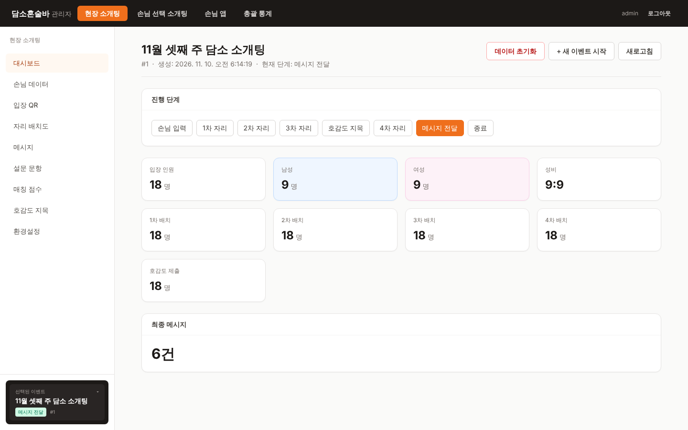
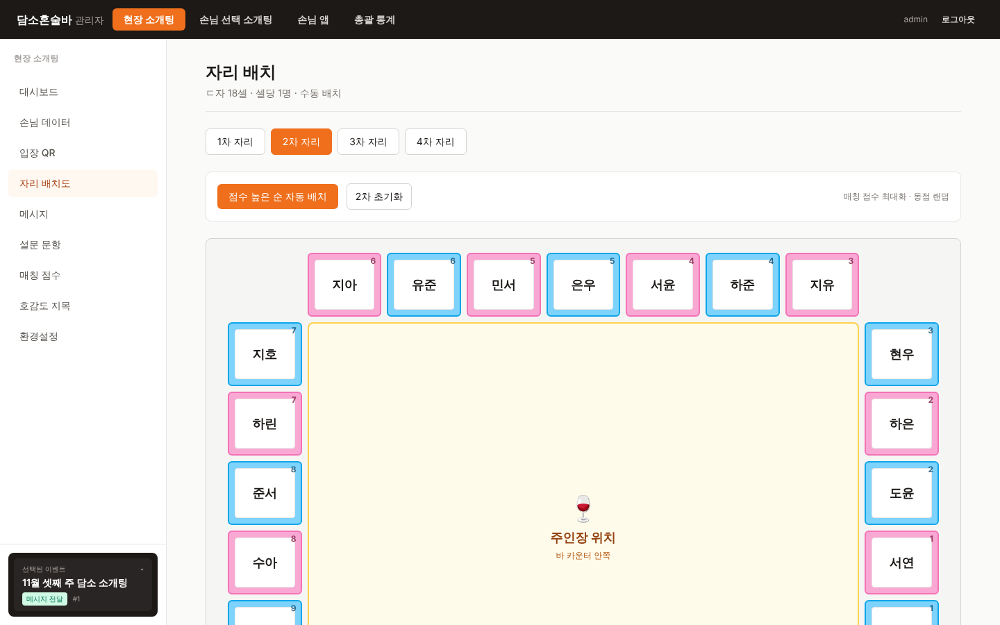
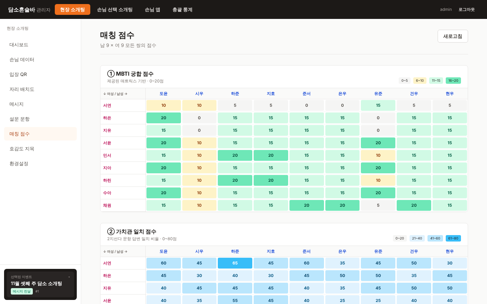
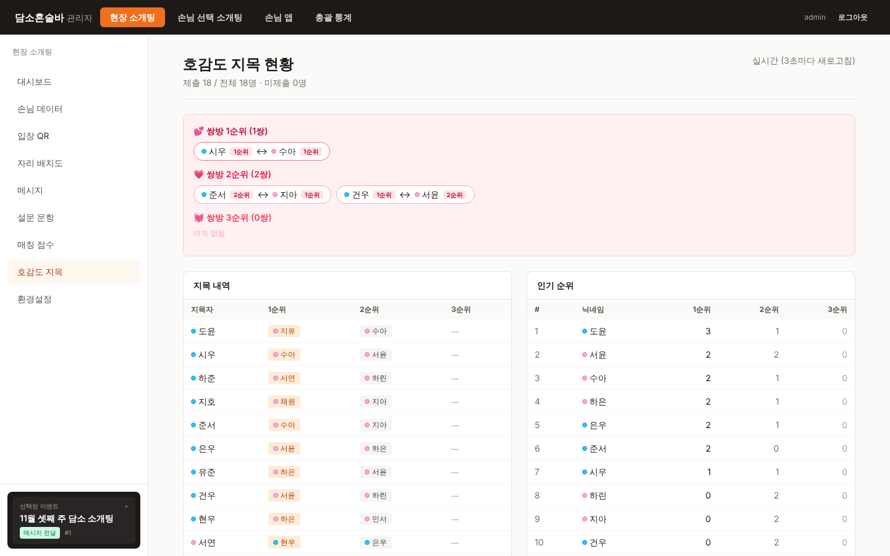
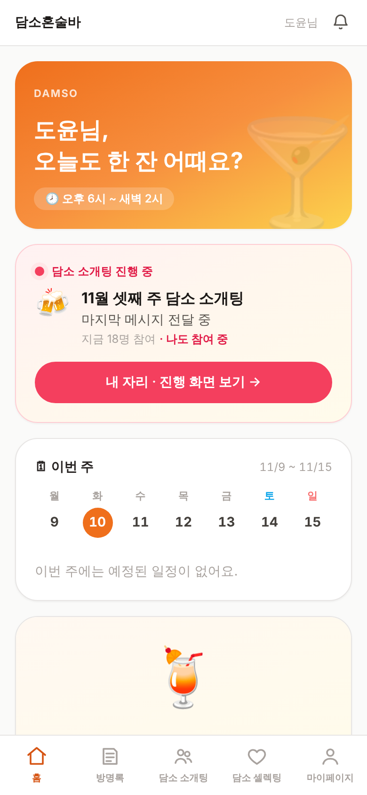
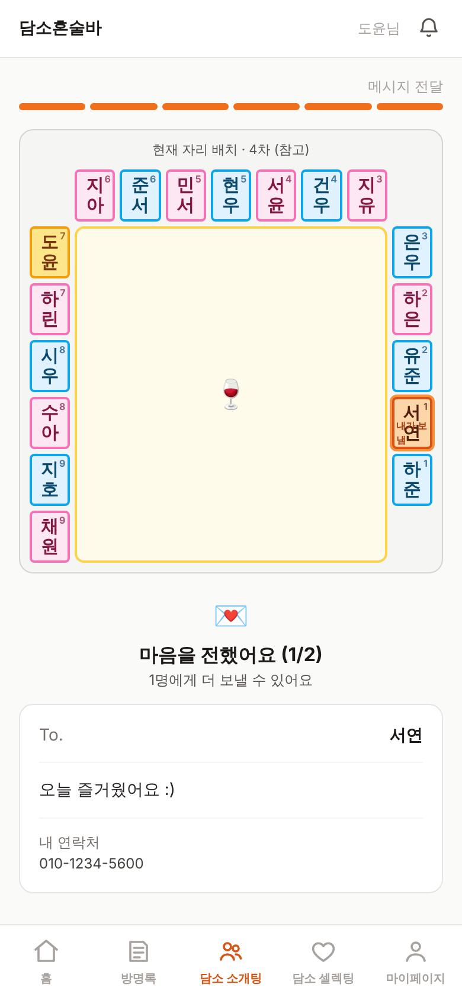
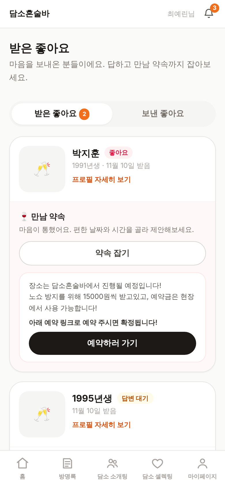

# 담소 — 매장 소개팅 이벤트 운영 플랫폼

혼술바에서 열리는 오프라인 소개팅 이벤트를 웹으로 옮긴 1인 개인 프로젝트입니다.
관리자는 PC에서 이벤트를 단계별로 진행하고, 손님은 휴대폰으로 자기 자리 확인, 호감도 지목, 메시지 전달을 합니다.
**18명이 네 번 자리를 바꾸는 동안 "누구를 누구 옆에 앉힐지"를 궁합 점수 기반 최적화 문제로 풀어 자동화한 것**이 핵심입니다.

| | |
|---|---|
| **기간** | 2026.06 ~ (약 3개월) |
| **인원** | 1인 (기획 · 백엔드 · 프론트엔드 · DB) |
| **백엔드** | Java 21 · Spring Boot 3.3 · Spring Data JPA · PostgreSQL 16 · Flyway |
| **프론트엔드** | React 18 · TypeScript · Vite · Tailwind CSS |
| **테스트 / CI** | JUnit 5 · Mockito · Testcontainers · GitHub Actions |
| **규모** | 엔티티 30개 · REST 엔드포인트 152개 · 테스트 37개 |

<br>

## 화면

### 관리자 (PC)

| 이벤트 대시보드 | 자리 배치 (2차: 궁합 점수 최대화) |
|---|---|
|  |  |
| **궁합 점수 행렬** (MBTI 20점 + 가치관 80점) | **호감도 지목 현황** (쌍방 지목 자동 집계) |
|  |  |

### 손님 앱 (모바일 PWA)

| 홈 | 내 자리 · 메시지 전달 | 셀렉팅 · 받은 좋아요 |
|---|---|---|
|  |  |  |

<sub>화면의 이름·연락처는 모두 더미 데이터입니다.</sub>

<br>

## 주요 기능

| 영역 | 기능 |
|---|---|
| **현장 소개팅** | 손님 등록 → 1~4차 자리 자동 배치 → 호감도 지목 → 메시지 전달까지 8단계 진행. 손님 화면은 4초 폴링으로 단계에 맞춰 바뀜 |
| **셀렉팅 (상시 소개팅)** | 프로필 등록 → 관리자 심사 → 좋아요(하루 2명, 72시간 후 자동 만료) → 쌍방 수락 시 이름 공개 → 만남 약속 → 웹 푸시 알림 |
| **회원 · 관리** | 아이디 가입과 카카오/네이버 로그인, 관리자 회원 심사, 통계, 게임방, 매장 캘린더, 방명록 |

<br>

## 기술적으로 고민한 것

### 1. 자리 배치를 할당 문제로 정형화
📄 [`SeatAssignmentService`](backend/src/main/java/com/damso/match/domain/event/service/SeatAssignmentService.java)

- 남녀 쌍의 궁합 점수를 간선 가중치로 보는 **이분 그래프 최대 가중치 매칭**으로 풀었습니다.
- 좌석이 최대 9석(9! = 362,880가지)이라 헝가리안 알고리즘 대신 **순열 완전탐색으로 정확한 최적해**를 구합니다. 탐색부는 메서드 하나로 격리해 나중에 교체할 수 있게 했습니다.
- 회차별 전략은 **점수 행렬만 바꾸고 탐색 코어는 공유**합니다. 2차는 점수 최대화, 3차는 같은 계산에서 부호만 뒤집어 최소화, 4차는 호감도 상호 지목 우선입니다.
- 여러 제약을 분기 없이 **가중치 하나로** 표현했습니다.
  - 이전 회차 자리 회피: `-1e15` 페널티
  - 동점 타이브레이킹: 미세 노이즈
  - 상호 지목 우선순위: `1000^tier` 지수 가중치로 사전식 순서
- 성비가 안 맞으면 **"짝 없음" 가상 열을 패딩**해 정사각 행렬로 만들어, 등록 순서가 늦은 사람이 늘 빠지는 버그를 없앴습니다.

### 2. 조회가 되는 개인정보 암호화
📄 [`DataCrypto`](backend/src/main/java/com/damso/match/global/security/DataCrypto.java) · [`EncryptedStringConverter`](backend/src/main/java/com/damso/match/global/security/EncryptedStringConverter.java)

- 실명·전화번호를 **AES-256-GCM**으로 컬럼 암호화했습니다. JPA `AttributeConverter`로 붙여서 서비스 코드는 평문만 다룹니다.
- IV를 무작위로 뽑으면 `findByPhone()` 같은 등호 조회가 깨집니다. 그래서 **IV를 평문의 HMAC으로 유도하는 결정적 암호화**를 택했습니다.
- 그 대가로 "같은 값끼리는 같다"는 사실이 드러나는데, 이 트레이드오프를 알고 선택했고 이유를 코드에 남겼습니다. 중복 가입 차단을 유지하려면 필요한 선택이었습니다.

### 3. 인증 경계를 URL 구조로
📄 [`AdminAuthInterceptor`](backend/src/main/java/com/damso/match/global/security/AdminAuthInterceptor.java) · [`AuthService`](backend/src/main/java/com/damso/match/domain/member/service/AuthService.java)

- 사용자 종류(관리자 / 회원 / 현장 손님)를 `api/admin`, `api/app`, `api/guest` 패키지와 URL로 나눠, **컨트롤러 위치만 보면 인증 여부를 알 수 있게** 했습니다.
- JWT 대신 **DB 저장 불투명 토큰**을 씁니다. 관리자가 회원을 즉시 차단해야 하는데, 자체 만료되는 JWT로는 "지금 당장 끊기"가 안 되기 때문입니다.
- 비밀번호는 BCrypt로 저장합니다. 인증만 필요해서 Spring Security 전체가 아니라 `spring-security-crypto`만 썼습니다.

### 4. 실제 PostgreSQL 위에서 도는 테스트
📄 [`IntegrationTest`](backend/src/test/java/com/damso/match/support/IntegrationTest.java) · [`SeatAssignmentServiceTest`](backend/src/test/java/com/damso/match/domain/event/service/SeatAssignmentServiceTest.java)

- **통합 테스트:** Testcontainers로 PostgreSQL 컨테이너를 띄우고, 앱 전체를 기동해 HTTP로 API를 호출합니다. Flyway 마이그레이션부터 컨트롤러, 서비스, DB까지 실제 경로를 그대로 지납니다.
  - 확인하는 것: 인증·인가, 개인정보가 DB에 암호문으로 저장되는지, 이벤트 진행, 셀렉팅 흐름
- **알고리즘 단위 테스트:** 구현을 베끼지 않고, 테스트가 **독립적인 브루트포스 오라클**을 갖고 "결과가 최적인가"라는 성질만 검증합니다.
- **CI:** GitHub Actions가 PR마다 백엔드 테스트와 프론트 빌드를 돌립니다.

### 5. 스키마 버전 관리
- 스키마는 Flyway(`V*__*.sql`)가 만들고, Hibernate는 `ddl-auto=validate`로 확인만 합니다. 엔티티와 테이블이 어긋나면 **앱이 아예 뜨지 않게** 했습니다.

<br>

## 트러블슈팅 — 개발 DB에서는 통과하고 PostgreSQL에서만 터진 500

- **증상:** 앱에서 등록하면 500, 관리자 화면에서 등록하면 정상이었습니다. 로컬에서도 재현되지 않았습니다.
- **원인:** 클래스에 `@Transactional(readOnly = true)`가 걸린 서비스에서, 앱 경로가 부르는 쓰기 메서드에만 `@Transactional`이 빠져 있었습니다. PostgreSQL은 읽기 전용 트랜잭션의 INSERT를 거부했습니다(SQLState 25006). 반면 당시 로컬 개발 DB였던 H2는 읽기 전용을 강제하지 않아 테스트가 통과했습니다.
- **해결:** 메서드에 쓰기 트랜잭션을 붙이고, 같은 패턴(클래스는 readOnly, 메서드는 쓰기)을 전부 점검했습니다.
- **이후:** H2를 걷어내고 개발·테스트 모두 PostgreSQL 하나로 통일했습니다. **관대한 DB에서 하는 테스트는 위험하다**는 걸 배운 경험입니다.

<br>

## 구조

```
backend/src/main/java/com/damso/match
├── api/            # 프레젠테이션 — 호출 주체별로 나눔 (= 인증 경계)
│   ├── admin/      #   /api/admin/**  관리자 토큰 (인터셉터가 일괄 검사)
│   ├── app/        #   /api/app/**    회원 토큰
│   └── guest/      #   /api/guest/**  현장 손님
├── domain/         # 비즈니스 로직 — event, dating, member, game, venue, notification, setting
└── global/         # 공통 — security(암호화·인터셉터), config, error

frontend/src
├── admin/          # 관리자 콘솔
├── user/           # 손님 앱 (PWA)
└── shared/         # 공용 타입·유틸
```

<br>

## 실행

Docker, JDK 21, Node 20이 필요합니다.

```bash
docker compose up -d       # PostgreSQL 16
./scripts/start.sh -r      # 백엔드(8080) + 프론트(5173) 빌드 후 실행
```

| 화면 | 주소 | 계정 |
|---|---|---|
| 손님 앱 | http://localhost:5173 | `test` / `test1234` |
| 관리자 | http://localhost:5173/admin | `admin` / `admin` |
| API 문서 (Swagger) | http://localhost:8080/swagger-ui.html | — |

```bash
cd backend && mvn test     # 테스트 (Docker 필요 — Testcontainers가 PostgreSQL을 띄움)
```

<br>

## 문서

- [docs/PORTFOLIO.md](docs/PORTFOLIO.md): 설계 판단과 트러블슈팅 상세
- [docs/DEVLOG.md](docs/DEVLOG.md): 시간순 개발 기록
